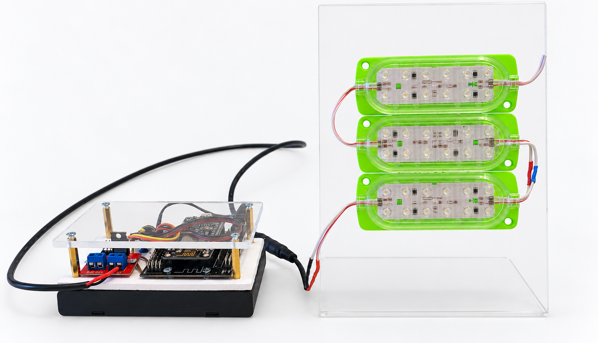
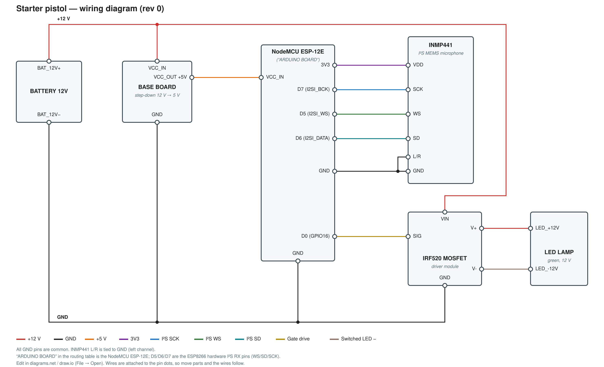

# starter-pistol

Firmware for a NodeMCU ESP-12E (ESP8266) board that listens on an I2S
microphone for a starter-pistol shot and fires an external MOSFET-driven
output when one is detected.



See [ABOUT.md](ABOUT.md) for the motivation (a visual start signal for deaf
and hard-of-hearing young runners) and the technical challenges involved.

Provided in two equivalent forms with the same logic:

- [`src/main.cpp`](src/main.cpp) — PlatformIO project (`platformio.ini`).
- [`arduino/starter-pistol/starter-pistol.ino`](arduino/starter-pistol/starter-pistol.ino) —
  Arduino IDE sketch. Open it via File > Open in the Arduino IDE (the folder
  name matches the `.ino` filename, as required). Select board
  "NodeMCU 1.0 (ESP-12E Module)" under Tools > Board.

## Hardware

| Signal          | NodeMCU pin | Notes                          |
|-----------------|-------------|---------------------------------|
| MOSFET gate     | `D0`        | Output, active-high             |

Pin assignments live in `pins.h` (duplicated for each build: `include/pins.h`
for PlatformIO, `arduino/starter-pistol/pins.h` for the Arduino IDE sketch).

### Wiring



Editable source: [`starter-pistol-wiring.drawio`](docs/wiring/starter-pistol-wiring.drawio)
(open in diagrams.net). Also available as a text
[netlist](docs/wiring/starter-pistol-netlist.txt) and an
[ASCII sketch](docs/wiring/starter-pistol-ascii.txt).

## Firmware

- `Serial` at 115200 baud for logging.
- I2S RX started at 16 kHz (`i2s_rxtx_begin` / `i2s_set_rate`) for the mic.
- Detection pipeline (FIR filter + noise-floor spike detector) ported as-is
  from `ESP8266-BUG-I2S-MIC` — see [`src/main.cpp`](src/main.cpp).
- No WiFi or UDP: this build only drives the local MOSFET output, it does not
  stream audio or telemetry over the network.

## Build

PlatformIO:

```bash
pio run
pio run -t upload
pio device monitor -b 115200
```

Arduino IDE: open `arduino/starter-pistol/starter-pistol.ino`, select
"NodeMCU 1.0 (ESP-12E Module)", then Upload.
