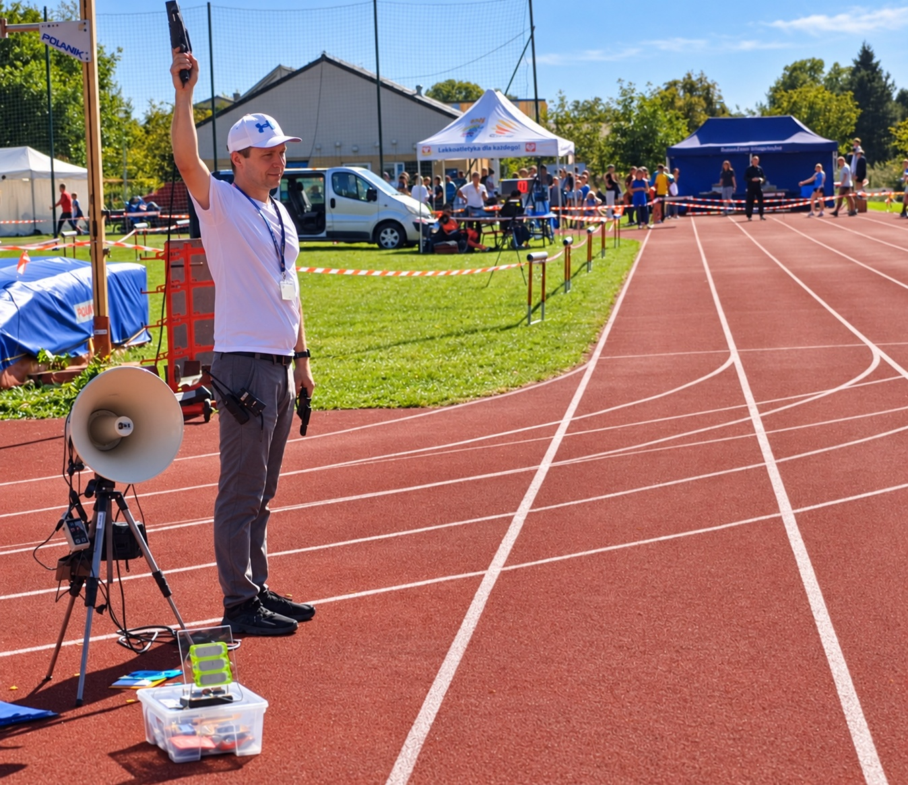
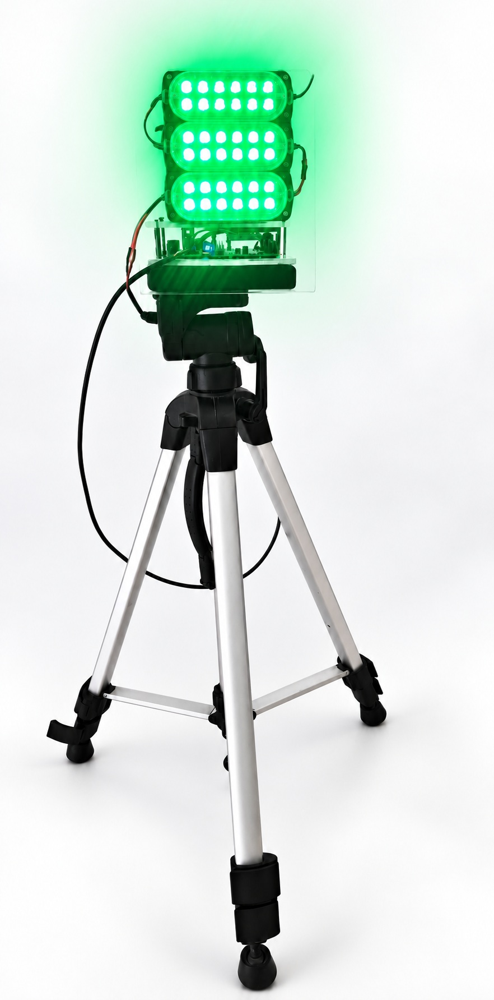
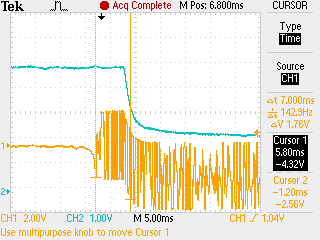
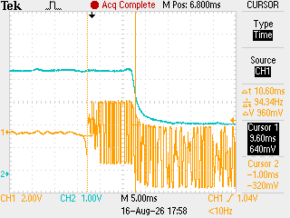

# Starter-pistol

Firmware for a NodeMCU ESP-12E (ESP8266) board that listens on an I2S
microphone for a starter-pistol shot and fires an external MOSFET-driven
output when one is detected.

It started as a weekend project. The weekend did not last long: assembly,
bench testing, measuring the shot-to-light delay and field-testing at real
competitions stretched it well beyond that. What is here is the result: a
working prototype that has already been used at the track. I proudly tested
it with a cap pistol and a professional electronic starter pistol (Domtel).


## Why

Race starts are announced by sound. For deaf and hard-of-hearing young
runners that signal isn't there: they end up watching the other runners for
the first sign of motion, which costs them time in every race. Most local
and amateur events have no visual start signal at all, and the systems used
at professional/Paralympic level are expensive and closed.

Wiring directly into the starter pistol is not an option:

1. **Proprietary systems.** Electronic starter pistols are tied into the
   official timing system, with licences, warranties and a defined way of
   operating that a third-party device cannot tap into.
2. **Sports regulations.** Anything connected to the timing/starting system
   is a potential source of interference, which is not allowed in official
   competition.

So the device **listens for the shot acoustically, just like a runner, and
turns it into a light signal.** It is standalone and connects to nothing.

## Technical challenges

- **Microphone.** Directional (cardioid) microphones reject off-axis noise
  better but cost much more. A cheap omnidirectional I2S MEMS microphone is
  used instead, so the detection logic has to do more of the work.
- **Background noise.** Crowds, wind, PA systems and nearby races must not
  cause false triggers.
- **Validation on a PC.** Thresholds and filtering are hard to judge on the
  device itself; sample data was pulled to a laptop by reusing tooling from
  another side project.
- **LED visibility.** An LED that looks bright indoors can be nearly
  invisible in direct sunlight — exactly where most races happen.
- **Packaging.** Finding a good stand/mount and the right LEDs took more
  iteration than the enclosure itself.
- **Weather.** The prototype is not fully sealed; it should cope with light
  rain, but no more than that.

A lot of this had to be done by hand, even with AI assistance: choosing and
testing the microphone, tuning detection against real noise, finding LEDs
visible in sunlight, and building the hardware.

## Testing

### Field testing

The device was used at athletics competitions with both a cap pistol and a
professional Domtel starter pistol. It proved resistant to speech, typical
ambient noise and gusts of wind.

<table>
  <tr>
    <td align="center"></td>
    <td align="center"></td>
  </tr>
  <tr>
    <td align="center"><sub>At a competition (face replaced with an AI-generated one for GDPR reasons).</sub></td>
    <td align="center"><sub>The lamp on its tripod stand, lit.</sub></td>
  </tr>
</table>

### Lab measurements

The full shot-to-light path was measured with an external microphone
capturing the onset of the acoustic impulse and a photoresistor detecting the
lamp turning on. This includes the whole system delay, including the response
on the LED lamp side. The measured **shot-to-light delay is about 5–10 ms**.

<table>
  <tr>
    <td align="center"></td>
    <td align="center"></td>
  </tr>
  <tr>
    <td align="center"><sub>End-to-end measurement: microphone → circuit → lamp (F0000TEK).</sub></td>
    <td align="center"><sub>Second measurement of the time from acoustic impulse to light (F0002TEK).</sub></td>
  </tr>
</table>

## Code

Provided in two equivalent forms with the same logic:

- [`src/main.cpp`](src/main.cpp) — PlatformIO project (`platformio.ini`).
- [`arduino/starter-pistol/starter-pistol.ino`](arduino/starter-pistol/starter-pistol.ino) —
  Arduino IDE sketch. Open it via File > Open in the Arduino IDE (the folder
  name matches the `.ino` filename, as required). Select board
  "NodeMCU 1.0 (ESP-12E Module)" under Tools > Board.

## Hardware

The prototype consists of:

- **Battery holder for 8× 1.5 V cells** (12 V total; 12V for LEDs) with a power switch.
- **Base board for NodeMCU v3** (ESP8266 shield) — carries the NodeMCU and
  breaks out power and pins.
- **NodeMCU v3** — main CPU (ESP8266).
- **INMP441** I2S MEMS microphone — bought as a breakout module for
  convenience.
- **IRF520 MOSFET module** — switches the 12 V supply to the LED lamp, driven
  active-high from `D0`. No optocoupler is needed, as the LEDs are a resistive
  load; the ready-made module is simply handy.
- **LED lamp** (12 V).

Keep the switch in the circuit: left running all the time, the device drains
a substantial amount of battery power.

On power-up the `D0` line normally blinks (the lamp flashes briefly) while the
ESP8266 boots, before the firmware drives it low. This is a handy check that
the battery, MOSFET module and lamp are all working.

| Signal          | NodeMCU pin | Notes                          |
|-----------------|-------------|---------------------------------|
| MOSFET gate     | `D0`        | Output, active-high             |

Pin assignments live in `pins.h` (duplicated for each build: `include/pins.h`
for PlatformIO, `arduino/starter-pistol/pins.h` for the Arduino IDE sketch).

### Wiring


Editable source: [`starter-pistol-wiring.drawio`](docs/wiring/starter-pistol-wiring.drawio)
(open in diagrams.net). Also available as a text
[netlist](docs/wiring/starter-pistol-netlist.txt) and an
[ASCII sketch](docs/wiring/starter-pistol-ascii.txt).

## Firmware

- `Serial` at 115200 baud for logging.
- I2S RX started at 16 kHz (`i2s_rxtx_begin` / `i2s_set_rate`) for the mic.
- Detection pipeline (FIR filter + noise-floor spike detector) ported as-is
  from `ESP8266-BUG-I2S-MIC` — see [`src/main.cpp`](src/main.cpp).
- No WiFi or UDP: this build only drives the local MOSFET output, it does not
  stream audio or telemetry over the network.

## Build

PlatformIO:

```bash
pio run
pio run -t upload
pio device monitor -b 115200
```

Arduino IDE: open `arduino/starter-pistol/starter-pistol.ino`, select
"NodeMCU 1.0 (ESP-12E Module)", then Upload.
